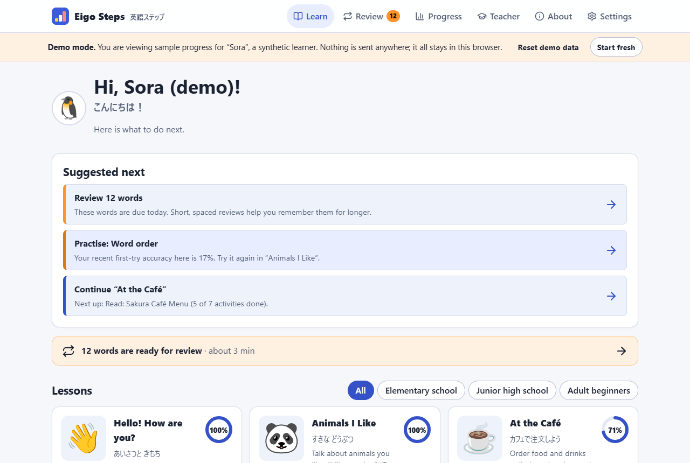
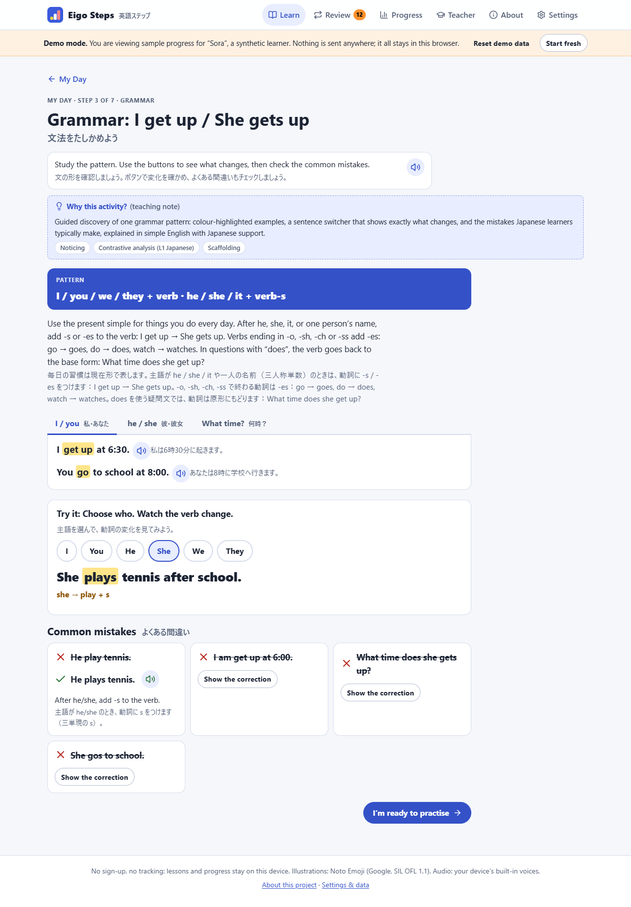
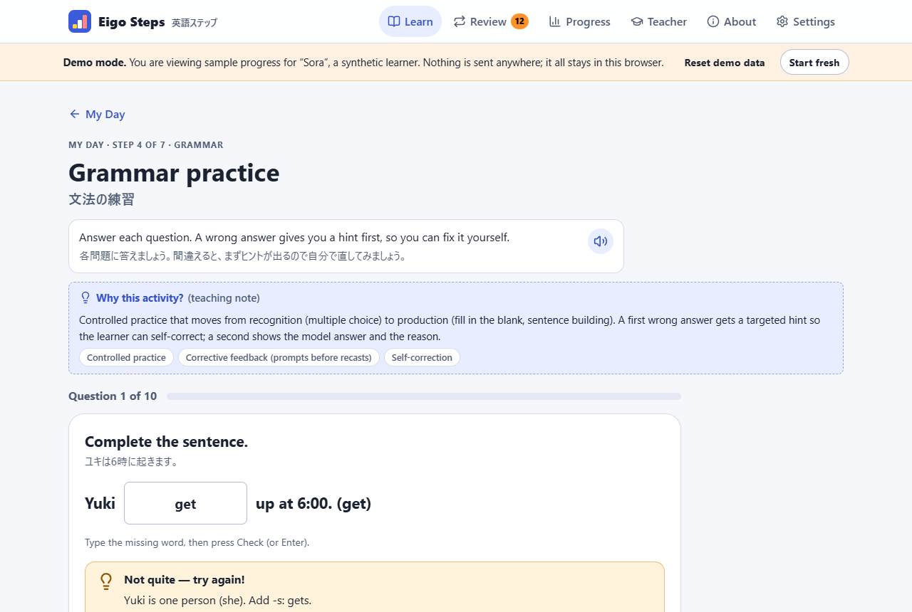
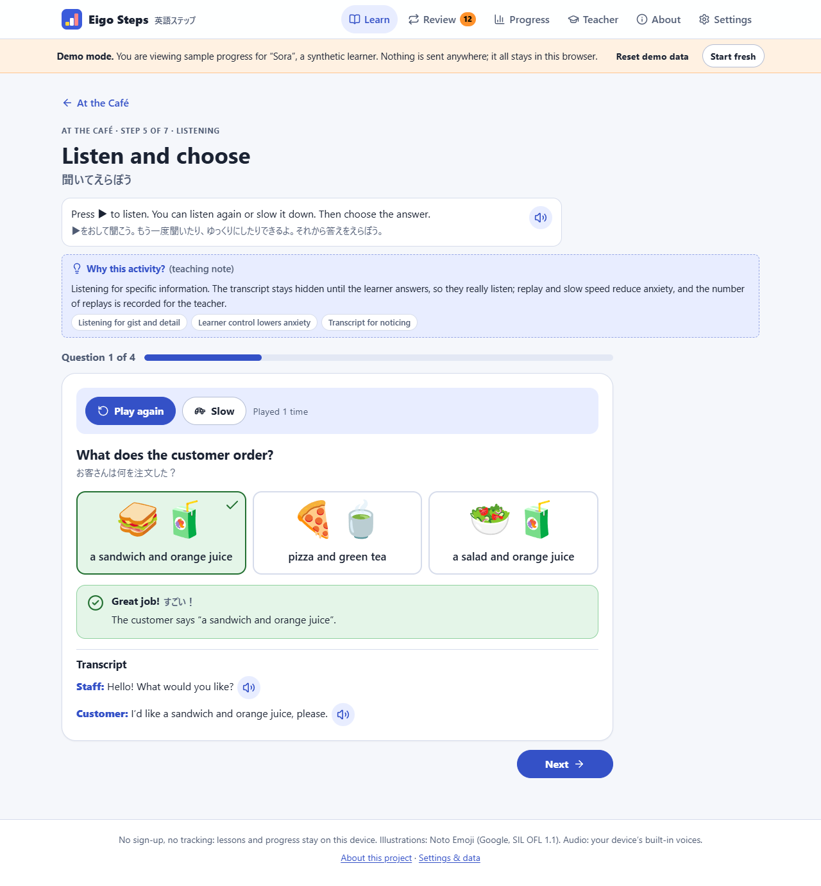
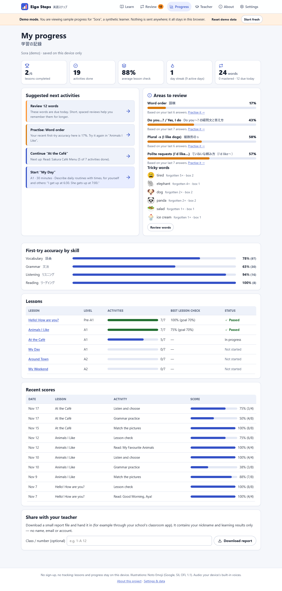
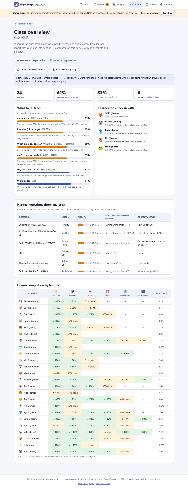
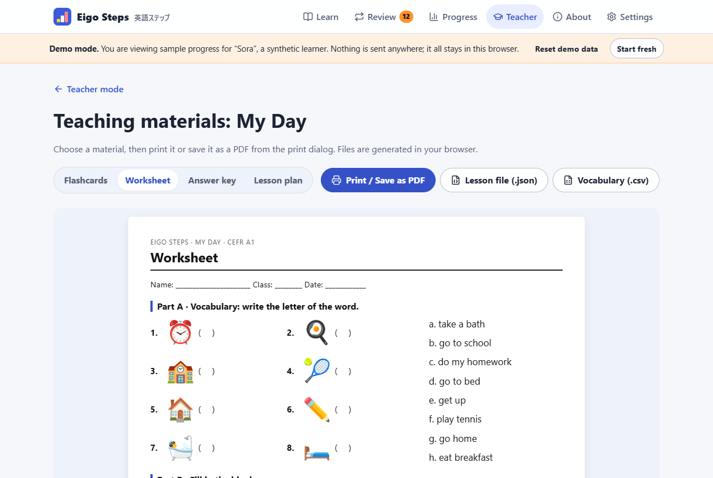

# Eigo Steps · 英語ステップ

**Interactive English for Japanese learners — CEFR Pre-A1 to A2**
Elementary school · Junior high school · Adult beginners

Eigo Steps is a working English learning platform with **six complete lessons**. They build
vocabulary, grammar, listening and reading, with **feedback designed around the mistakes Japanese
speakers actually make**, Leitner **spaced review**, a **progress dashboard**, and a **teacher
mode** for creating lessons, printing materials and seeing where a class needs help.

No registration, no server, no tracking: lessons and progress stay in the learner's browser.

**Live demo:** _add your GitHub Pages URL here after the first deploy (see [Deploy](#deploy))._
**For recruiters:** [5-minute guide](docs/RECRUITER_GUIDE.md) · [日本語ガイド](docs/RECRUITER_GUIDE.ja.md) · [Case study](docs/CASE_STUDY.md)



## What's inside

| Area             | Features                                                                                                                                                                                                                       |
| ---------------- | ------------------------------------------------------------------------------------------------------------------------------------------------------------------------------------------------------------------------------ |
| **Vocabulary**   | Illustrated cards with audio (normal and slow) and highlighted example sentences; picture-word matching; Leitner spaced review (5 boxes)                                                                                       |
| **Grammar**      | Interactive explanations (tabs, sentence switcher, common-mistake cards); multiple choice; fill in the blank (word bank or typing); sentence building; hint-first corrective feedback                                          |
| **Listening**    | Two-voice dialogues; play, replay, slow speed; text or picture answers; transcript revealed after answering                                                                                                                    |
| **Reading**      | Short level-appropriate texts; tap underlined words for an explanation + Japanese; read-aloud; comprehension questions                                                                                                         |
| **Progress**     | Lesson completion, quiz scores, focus areas below 70%, tricky words, suggested next activities with reasons, report file for the teacher                                                                                       |
| **Teacher mode** | Create and edit lessons (vocabulary, grammar, questions, listening, reading); preview as a student; print flashcards, worksheet, answer key and lesson plan; lesson JSON and vocabulary CSV; class overview with item analysis |
| **Demo mode**    | Explore with a synthetic learner and a synthetic class of 24, with no sign-up; reset at any time; "why this activity?" notes on every activity                                                                                 |

**Six lessons:** 👋 Hello! How are you? (Pre-A1) · 🐼 Animals I Like (A1.1) · ☕ At the Café (A1.2) ·
⏰ My Day (A1.3) · 🗺️ Around Town (A2.1) · 🎆 My Weekend (A2.1). Each has learning objectives, a
target level, student and teacher instructions, success criteria, a feedback approach and an
assessment strategy.

|                                               |                                                                    |                                                                  |
| --------------------------------------------- | ------------------------------------------------------------------ | ---------------------------------------------------------------- |
|    |       |                   |
|  |  |  |

## Learning design in brief

- **Present → notice → practise → apply → check → review**, the same sequence in every lesson.
- **Dual coding** (picture + sound + text), **retrieval practice** and **spaced review**.
- **Hint first, model answer second**: corrective feedback that lets learners self-correct.
  Rule-based diagnosis covers missing -s, wrong past forms, word order and spelling, and accepts
  full-width keyboard input. No paid AI is needed.
- **Japanese support you can fade**, picture-only answers for young learners, slow audio, and
  transcripts for deaf or hard-of-hearing learners.

Rationale, limitations and an evaluation plan: [docs/CASE_STUDY.md](docs/CASE_STUDY.md).

## Engineering in brief

- **TypeScript (strict) + React 19 + Vite**, with a framework-free domain layer (grading, spaced
  review, analytics) that is fully unit-tested.
- **Zod schemas** validate every lesson (built-in, teacher-made or imported) with length limits and
  cross-field rules. Lesson text is never rendered as HTML.
- **Privacy and security by design:** no backend, no accounts, nickname only; a strict Content
  Security Policy blocks connections to any other origin. Safe imports (size limit, schema, id
  checks), CSV-injection-safe exports, dependencies installed with a 14-day release cooldown, and
  SHA-pinned CI actions.
- **Accessible and mobile-friendly:** native controls, ARIA live feedback, focus management,
  `lang="ja"` markup, dark mode, reduced motion; axe-core checks in CI.
- **Tests:** 101 unit and integration tests (Vitest + Testing Library) and 47 browser E2E tests
  (Playwright, desktop + mobile), run against the production build.

Details: [docs/TECHNICAL.md](docs/TECHNICAL.md).

## Run it locally

Requires Node.js 22.12+ (Node 24 recommended).

```bash
npm ci
npm run dev        # http://localhost:5188
```

| Command                             | What it does                                                                                                                                |
| ----------------------------------- | ------------------------------------------------------------------------------------------------------------------------------------------- |
| `npm test`                          | Unit + integration tests                                                                                                                    |
| `npm run test:e2e`                  | Builds the production bundle and runs the Playwright tests (uses Microsoft Edge on Windows; `PW_CHANNEL=bundled` for Playwright's Chromium) |
| `npm run verify`                    | Format check, lint, type-check, tests, build and E2E                                                                                        |
| `npm run build` / `npm run preview` | Static site in `dist/` / serve it at http://localhost:4188                                                                                  |
| `npm run screenshots`               | Regenerate `docs/screenshots`                                                                                                               |
| `npm run illustrations`             | Download any new emoji illustrations used in `src/`                                                                                         |

## Deploy

The build is a static site with relative paths and hash routing, so it works on any static host.

**GitHub Pages:** push to `main`, then set _Settings → Pages → Source_ to **GitHub Actions**. The
`Deploy live demo` workflow tests, builds and publishes it. Other hosts: upload `dist/`.

## Credits and licence

- Code and original lesson content: MIT licence (see [LICENSE](LICENSE)).
- Illustrations: [Noto Emoji](https://github.com/googlefonts/noto-emoji), © Google LLC, SIL Open
  Font License 1.1 (see [THIRD_PARTY_NOTICES.md](THIRD_PARTY_NOTICES.md)).
- Audio: the speech voices built into the learner's device (Web Speech API).
- All learner data in the demo is synthetic; names are invented pseudonyms.
