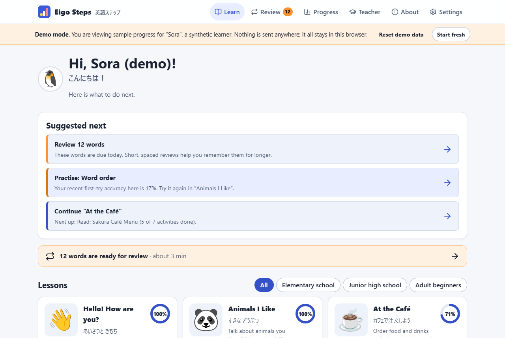
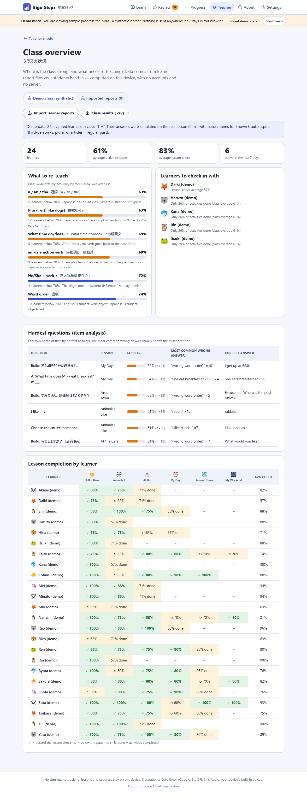

# Case study — Eigo Steps

**An interactive English platform for Japanese learners at CEFR Pre-A1 to A2**

> Six complete lessons for vocabulary, grammar, listening and reading, with feedback built around
> the predictable mistakes Japanese speakers make. Spaced review, progress tracking and teacher
> tools are included. It runs in any browser with no accounts, and no learner data leaves the device.

---

## 1. The teaching problem

English teachers in Japan, whether ALTs team-teaching with a JTE, eikaiwa instructors or junior
high specialists, face the same set of constraints:

1. **Little individual practice time.** A class of 30–40 students and 45–50 minute lessons leave
   each learner only a few minutes of active practice. Elementary schools get even less contact time:
   foreign language activities in grades 3–4, and English as a formal subject only from grade 5
   (Course of Study, implemented 2020).
2. **Predictable, L1-driven errors that need targeted feedback.** Japanese has no articles, no
   plural endings, no subject–verb agreement and puts the verb last. The same errors appear year
   after year: _“He play tennis.”_, _“I like dog.”_, _“Where is station?”_, _“I am play
   soccer.”_, _“It was very enjoy.”_ A red ✗ does not tell a learner _why_ the answer is wrong.
3. **Anxiety about being wrong in front of peers.** Foreign language classroom anxiety (Horwitz,
   Horwitz & Cope, 1986) is a well-documented barrier, and it is very visible in Japanese
   classrooms, where learners are reluctant to answer publicly. Private, low-stakes practice lowers
   that barrier.
4. **Forgetting.** Vocabulary taught once in a unit is often forgotten by the next test. Learners
   need spaced retrieval, but teachers have no time to schedule it for every student.
5. **Teachers lack data and preparation time.** Without per-item data, it is hard to know whether a
   class-wide problem is _plural -s_ or _third-person -s_. Making flashcards, worksheets and answer
   keys for each unit takes many hours.
6. **Devices exist, but privacy rules are strict.** Since the GIGA School programme, most
   elementary and junior high students have their own device. Many tools still require accounts,
   send data to servers or need paid AI services, which school boards are cautious about.

**Design goal:** a tool a teacher could use with a class _tomorrow_, on school devices, without
registration or personal data. It should give every learner more practice with better feedback, and
give the teacher actionable information plus printable materials.

## 2. Target learners

| Group                              | Typical context                                                      | CEFR        | Design consequences                                                                                                                                                          |
| ---------------------------------- | -------------------------------------------------------------------- | ----------- | ---------------------------------------------------------------------------------------------------------------------------------------------------------------------------- |
| **Elementary school** (grades 3–6) | Gaikokugo katsudō / English class, often with an ALT; tablets (GIGA) | Pre-A1 → A1 | Picture-first tasks; audio for every word; picture-only listening answers (no reading needed); instructions in simple hiragana Japanese; large tap targets; short activities |
| **Junior high school** (years 1–2) | Textbook-based grammar progression; Eiken Grade 5–3 goals            | A1 → A2     | Explicit grammar with L1 contrast; typed answers (production); sentence building for word order; more demanding listening (times, prices)                                    |
| **Adult beginners**                | Eikaiwa, community classes, workplace, travel                        | Pre-A1 → A2 | Practical topics (café, directions, weekend talk); polite pragmatics (_I'd like…, please_); optional Japanese support that can be faded                                      |

Levels follow the CEFR (Council of Europe, 2020) with the finer **CEFR-J** bands widely used in
Japan (Tono, 2013): Pre-A1, A1.1–A1.3, A2.1. Topics map onto the MEXT Course of Study themes
(greetings, likes, food, daily life, town, past events) but use original texts, not textbook content.

## 3. Learning objectives

Every module states its objectives as _can-do statements_, together with success criteria and an
assessment strategy.

| Module                     | Level  | Objectives (summary)                                                                                                |
| -------------------------- | ------ | ------------------------------------------------------------------------------------------------------------------- |
| 👋 **Hello! How are you?** | Pre-A1 | Greet people; ask _How are you?_ and answer _I'm + feeling_; recognise 8 feelings by ear; read a short dialogue     |
| 🐼 **Animals I Like**      | A1.1   | Name 8 animals; _I like + plural_ (_I like cats_); _Do you like…? — Yes, I do / No, I don't_                        |
| ☕ **At the Café**         | A1.2   | Order politely with _I'd like…, please_; accept or refuse offers; understand prices in yen (‑teen/‑ty); read a menu |
| ⏰ **My Day**              | A1.3   | Describe routines with times; _he/she + verb‑s_; _What time do/does…?_; understand clock times                      |
| 🗺️ **Around Town**         | A2.1   | Ask the way politely; give directions (imperatives); _next to / in front of / between_; follow spoken directions    |
| 🎆 **My Weekend**          | A2.1   | Past tense (regular and irregular); _What did you do?_ — _I went…_; _It was fun_; read a diary                      |

**Success criteria** are observable and checkable, e.g. _“Adds -s to verbs after he/she in at
least 4 of 5 items”_ or _“Picks the correct item or price in 3 of 4 listening tasks.”_ The lesson
check has a pass mark per module (70–75%).

## 4. Why this interaction design

Every lesson follows the same **present → notice → practise → apply → check → review** sequence.
Each step is a deliberate choice:

| Activity                                | What the learner does                                                                                                                 | Why it is designed this way                                                                                                                                                                                    |
| --------------------------------------- | ------------------------------------------------------------------------------------------------------------------------------------- | -------------------------------------------------------------------------------------------------------------------------------------------------------------------------------------------------------------- |
| **Learn the words** (illustrated cards) | Sees a picture, hears the word (normal and slow), reads a highlighted example sentence; Japanese meaning optional                     | **Dual coding** (Paivio, 1986): picture + sound + text create several memory routes. Meaning comes before form, without relying on translation. Finishing the cards puts the words into spaced review.         |
| **Match the pictures**                  | Taps a picture and its word in rounds of up to 6; words are spoken when tapped                                                        | **Retrieval practice** straight after presentation (Roediger & Karpicke, 2006). Pre-literate children can play by sound. _First-try_ accuracy is recorded, not just completion.                                |
| **Grammar explanation**                 | Tabs of colour-highlighted examples; a **sentence switcher** (tap _She_ → _She **plays** tennis._); “Common mistakes” cards to reveal | **Noticing** (Schmidt, 1990): the switcher isolates exactly what changes. The mistakes are **contrastive**: they target the L1-transfer errors above and explain them in simple English with Japanese support. |
| **Grammar practice**                    | Multiple choice → fill in the blank (word bank or typing) → sentence building from tiles                                              | Controlled practice moving from **recognition to production**. Sentence building trains English word order (SVO vs Japanese SOV) without the burden of spelling.                                               |
| **Listen and choose**                   | Dialogues with two voices; Play / Play again / Slow; picture or text answers; the transcript appears **after** answering              | Listening for specific information. Learner control over replay and speed **lowers anxiety**. A hidden transcript forces real listening; showing it afterwards supports noticing (listen while reading).       |
| **Read**                                | A short text with underlined words: tap for an English explanation + Japanese; optional read-aloud                                    | **Comprehensible input** (Krashen, 1982): glosses keep the text at i+1 without a dictionary. Questions mix stated detail with simple inference.                                                                |
| **Lesson check**                        | 8–10 mixed items, one try each, no hints                                                                                              | **Summative** check with interleaved skills; compared with the pass mark and fed into “areas to review”.                                                                                                       |
| **Spaced review**                       | Due words come back in a 5-box **Leitner** system (1 → 3 → 7 → 14 → 30 days)                                                          | The **spacing effect** is one of the most robust findings in learning research (Cepeda et al., 2006). Leitner boxes are simple enough to explain to a nine-year-old.                                           |

### Feedback design: hint first, model second

Corrective feedback research distinguishes _prompts_, which push the learner to self-correct, from
_recasts_, which give the correct form (Lyster & Ranta, 1997). Prompts lead to more learner uptake.
Eigo Steps therefore uses a two-step sequence on every practice item:

1. **First mistake → a targeted hint**, aimed at the _cause_. For example, typing _play_ for _plays_
   gives _“Look at the subject. With he, she, it or one person's name, add -s.”_ Typing _goed_ gives
   _“Good try! ‘go’ is an irregular verb, so it doesn't use -ed.”_
2. **Second mistake → the model answer**, with audio and the reason.

Hints come from three sources: answer-specific feedback written into the content, and a
**rule-based diagnosis** of typical errors (missing -s, wrong past forms, over-regularisation,
spelling slips, word order, distractor words). Typed answers from a Japanese keyboard in full-width
mode (ｇｅｔｓ) are normalised and accepted. None of this needs a paid AI service: the error patterns
are predictable, so the feedback can be too.

Feedback also follows what Hattie and Timperley (2007) describe as effective. It is about the task
and the process, not the person ("Look at the subject…", not "Wrong!"). Scores count first-try
answers, while the completion screen also credits the corrections the learner made.

### Scaffolding that can be faded

- **Japanese support** (instructions, meanings, explanations) is a single switch, so the teacher
  can reduce L1 support as learners progress.
- **Teaching notes** ("Why this activity?") are visible in demo mode and can be turned off for
  students.
- **Accessibility:** an "always show transcripts" option for deaf or hard-of-hearing learners;
  keyboard and screen-reader support throughout; Japanese text is marked `lang="ja"` so screen
  readers switch voice.

## 5. How the platform supports learning (and teaching)

**For learners**

- More practice per lesson, at their own pace, privately and without fear of public mistakes.
- Feedback that explains _why_, plus a second chance to fix it themselves.
- Words come back for review just before they would be forgotten.
- A progress page that shows lessons completed, scores, **areas to review** (focus areas below 70%
  first-try accuracy), **tricky words**, and **suggested next activities**. Each suggestion gives
  its reason (_“Your recent first-try accuracy here is 43%”_).

**For teachers**

- **Teacher mode**: create lessons, edit vocabulary, write questions (multiple choice, gap fill,
  sentence building, listening scripts, reading with glosses), and preview each activity exactly as
  students see it. Activities, instructions and teaching notes are generated from the content, so a
  new lesson automatically follows the same research-informed sequence.
- **Export**: printable flashcards, a worksheet with a matching answer key, a one-page lesson plan,
  a lesson file to share with colleagues, and a vocabulary CSV for spreadsheets or flashcard apps.
- **Class overview**: students hand in a small report file (nickname + results; no account and no
  server). The teacher sees class-wide focus areas, **item analysis** (facility index plus the most
  common wrong answer, which usually reveals the misconception) and the learners to check in with.
- In the classroom the app supports, rather than replaces, the teacher: the lesson plans pair
  device work with whole-class chants, role-plays and information-gap tasks.

## 6. Limitations

Being honest about limits is part of good instructional design:

1. **Synthetic voices.** Audio comes from the device's built-in voices. Quality varies (excellent on
   recent Windows, iPad and Chromebook devices, robotic on some older ones) and does not model
   connected speech as well as a human recording. Teacher-recorded audio would be the next
   improvement.
2. **No speaking or pronunciation assessment.** Speaking stays in the classroom: the lesson plans
   include speaking tasks, but the app does not evaluate speech.
3. **Feedback covers anticipated errors.** The rule-based diagnosis handles the most frequent
   patterns well. Unexpected answers get a general hint, then the model answer.
4. **Local-first trade-offs.** Progress lives in one browser. Clearing site data or changing device
   loses it, unless the learner downloads a backup. Class data moves as files, which is private but
   less convenient than a school-managed server.
5. **Content volume.** Six lessons show the design, but a full course would need many more. The
   editor and import/export make that a content task, not an engineering task.
6. **Not yet validated with real classes.** All demo data is synthetic. The design draws on
   established research, but its effectiveness for _these_ learners still has to be measured (see
   below). The Japanese support text should also be reviewed by a Japanese teacher colleague.
7. **Accessibility testing** is automated (axe-core, WCAG 2.1 AA) plus keyboard testing. It has not
   yet been tested with screen-reader users.

## 7. How effectiveness could be evaluated

A realistic plan for a pilot with two parallel junior high classes over one term:

| Question                                                        | Measure                                                                                                                                         | Design                                                                                                                                                                                                           |
| --------------------------------------------------------------- | ----------------------------------------------------------------------------------------------------------------------------------------------- | ---------------------------------------------------------------------------------------------------------------------------------------------------------------------------------------------------------------- |
| Does it improve learning of the target forms?                   | Pre-test, immediate post-test and **delayed post-test** (4 weeks) on the six target structures and vocabulary, including items in a new context | Class A uses Eigo Steps for 10–15 minutes per lesson; class B does the same content on paper; switch for the next unit (crossover) to control for class differences. Report **effect sizes**, not only p-values. |
| Does spaced review improve retention?                           | Delayed vocabulary test, compared by Leitner box history                                                                                        | Within-class: words reviewed in the app vs words only practised in class                                                                                                                                         |
| Does hint-first feedback work better than answer-first?         | Self-correction rate after a hint; later accuracy on the same structure                                                                         | Within-subjects A/B: alternate feedback type per item and compare later accuracy                                                                                                                                 |
| Does it reduce anxiety and increase willingness to participate? | Short anxiety and motivation questionnaires (adapted from FLCAS), and willingness to answer in class                                            | Before and after; short student interviews                                                                                                                                                                       |
| Is it usable in real classrooms?                                | Teacher interviews, preparation time saved, technical problems log                                                                              | Two teachers (JTE + ALT) keep a short log for each lesson                                                                                                                                                        |
| Is the assessment working?                                      | Item analysis: facility and discrimination of each item; distractor analysis                                                                    | Revise items that are too easy, too hard or that do not discriminate                                                                                                                                             |

**Ethics and privacy:** permission from the school and guardians; learners use nicknames;
analysis uses only the anonymous report files; no data is collected by the app itself.

Success would look like a medium effect on the delayed post-test, improved accuracy on L1-transfer
structures (third-person -s, plural -s, articles), lower reported anxiety, and teachers choosing to
keep using it.

---

## References

- Cepeda, N. J., Pashler, H., Vul, E., Wixted, J. T., & Rohrer, D. (2006). Distributed practice in verbal recall tasks: A review and quantitative synthesis. _Psychological Bulletin, 132_(3), 354–380.
- Council of Europe. (2020). _Common European Framework of Reference for Languages: Learning, teaching, assessment — Companion volume._
- Hattie, J., & Timperley, H. (2007). The power of feedback. _Review of Educational Research, 77_(1), 81–112.
- Horwitz, E. K., Horwitz, M. B., & Cope, J. (1986). Foreign language classroom anxiety. _The Modern Language Journal, 70_(2), 125–132.
- Krashen, S. D. (1982). _Principles and practice in second language acquisition._ Pergamon.
- Leitner, S. (1972). _So lernt man lernen._ Herder.
- Lyster, R., & Ranta, L. (1997). Corrective feedback and learner uptake. _Studies in Second Language Acquisition, 19_(1), 37–66.
- MEXT. (2017). _小学校学習指導要領 / 中学校学習指導要領_ (Courses of Study for elementary and junior high schools).
- Nation, I. S. P. (2013). _Learning vocabulary in another language_ (2nd ed.). Cambridge University Press.
- Paivio, A. (1986). _Mental representations: A dual coding approach._ Oxford University Press.
- Roediger, H. L., & Karpicke, J. D. (2006). Test-enhanced learning. _Psychological Science, 17_(3), 249–255.
- Schmidt, R. W. (1990). The role of consciousness in second language learning. _Applied Linguistics, 11_(2), 129–158.
- 投野由紀夫 編 (Tono, Y., Ed.). (2013). _CAN-DOリスト作成・活用 英語到達度指標CEFR-Jガイドブック._ 大修館書店.
