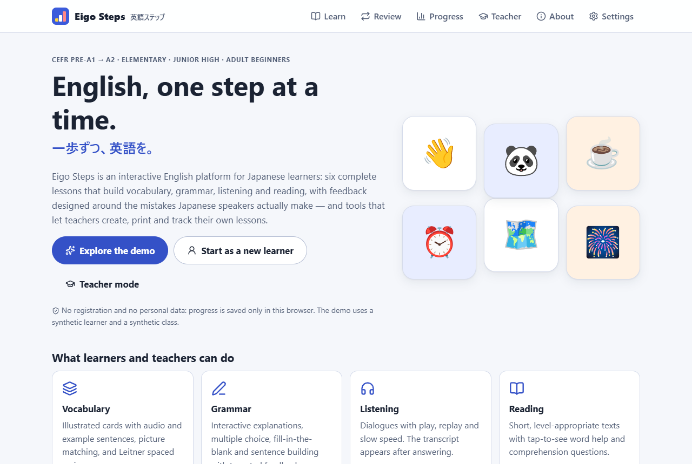
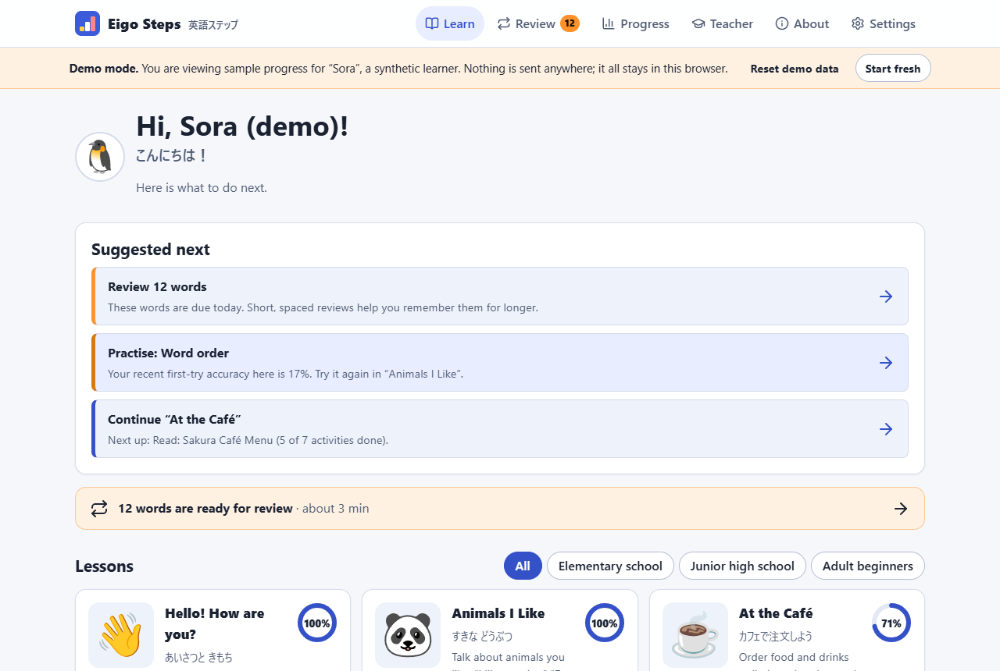
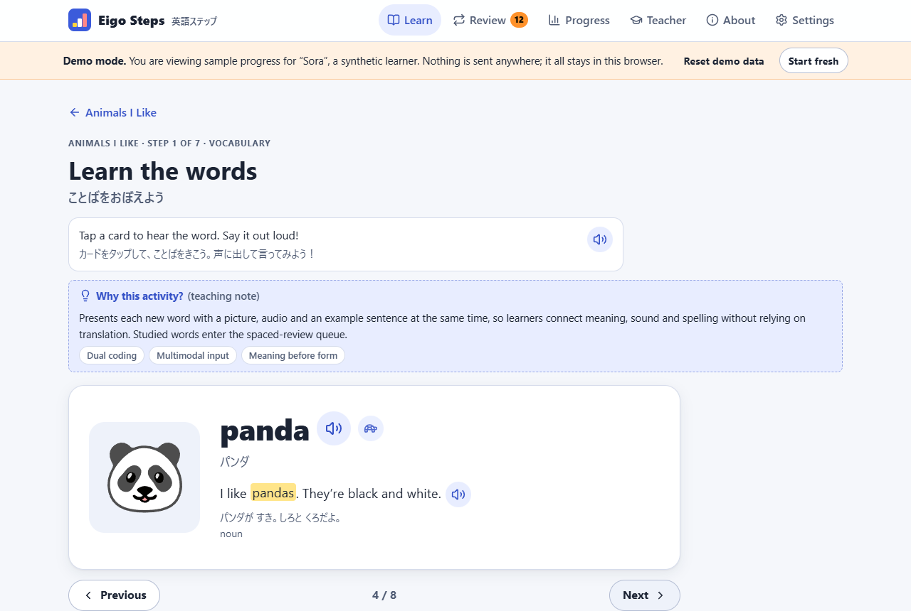
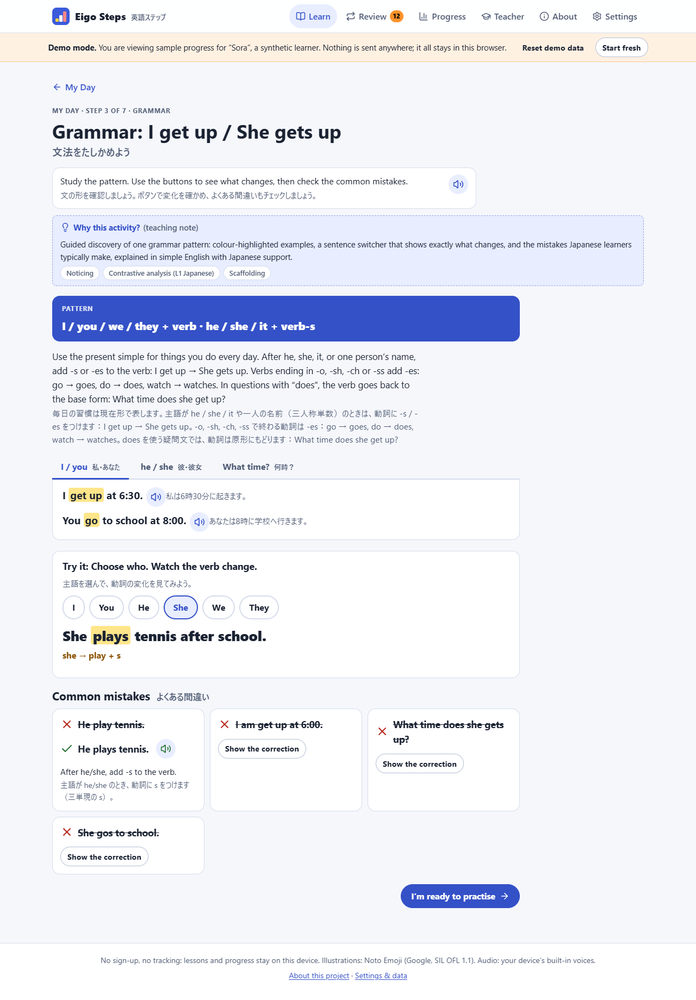
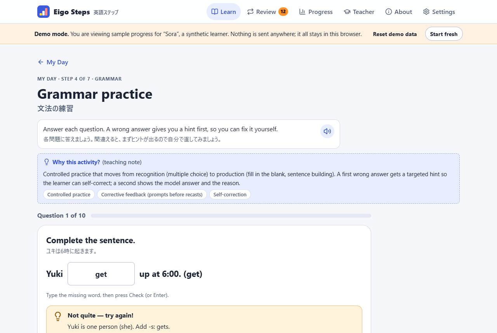
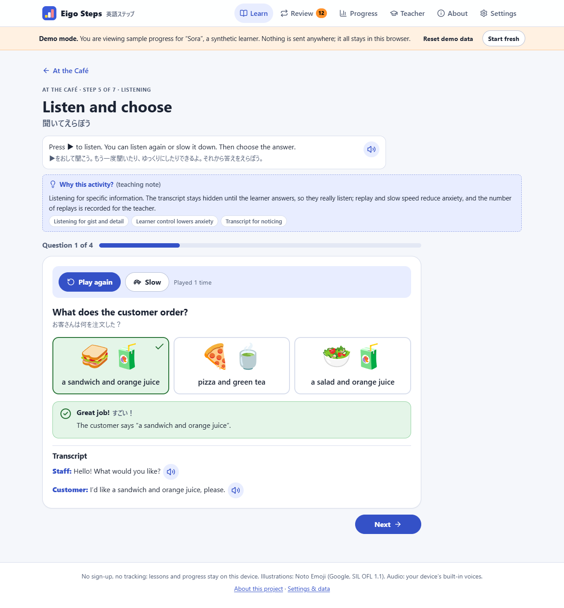
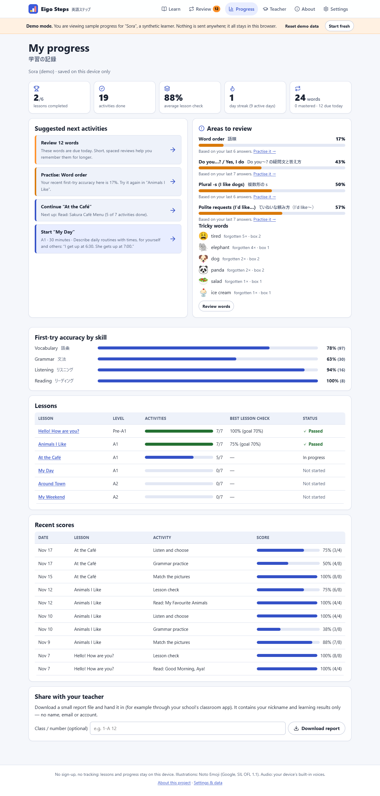
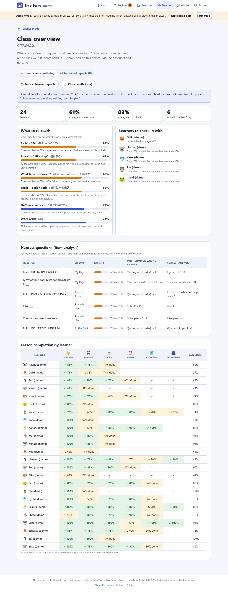

# Eigo Steps（英語ステップ）採用ご担当者様向けガイド

**ひとことで言うと：** Eigo Steps は、日本の小学生・中学生・大人の初級学習者（CEFR Pre-A1〜A2）向けに開発した、実際に使える英語学習プラットフォームです。授業設計、日本人学習者に多い誤りへのフィードバック、学習評価、そして個人情報を集めずにICTで先生の負担を減らす工夫を、実際に動く形でお見せするために制作しました。

English version: [RECRUITER_GUIDE.md](RECRUITER_GUIDE.md)

---

## 5分でわかるデモの見方

[ライブデモ](https://coderremarks.github.io/eigo-steps/)を開いてください。登録は不要で、すべてブラウザの中だけで動きます。

| 目安 | 操作                                                                                                                                                | ご覧いただけること                                                                                                                           |
| ---- | --------------------------------------------------------------------------------------------------------------------------------------------------- | -------------------------------------------------------------------------------------------------------------------------------------------- |
| 0:30 | トップページの **Explore the demo** を押す                                                                                                          | 架空の学習者「Sora」のデータ（2レッスン修了、1レッスン学習中、苦手分野、復習が必要な単語）。おすすめの学習には、それぞれ理由が表示されます。 |
| 1:00 | **My Day → Grammar**（[#/learn/my-day/grammar](https://coderremarks.github.io/eigo-steps/#/learn/my-day/grammar)）で **He / She** を押す            | 対話型の文法説明。主語を切り替えると動詞の変化（He play**s**）がひと目でわかります。日本人に多い誤りのカードもあります。                     |
| 1:00 | **My Day → Grammar practice**（[#/learn/my-day/practice](https://coderremarks.github.io/eigo-steps/#/learn/my-day/practice)）で **get** と入力      | 訂正フィードバック。まず「Yuki は一人（she）なので -s をつけよう」というヒントを出し、自分で直す機会を与えます。正解は2回目に表示します。    |
| 0:45 | **At the Café → Listen and choose**（[#/learn/cafe-ordering/listening](https://coderremarks.github.io/eigo-steps/#/learn/cafe-ordering/listening)） | 何度でも再生・スロー再生ができるリスニング。スクリプトは解答後に表示されます。                                                               |
| 0:45 | **Progress**（[#/progress](https://coderremarks.github.io/eigo-steps/#/progress)）                                                                  | レッスンの達成状況、テストの点数、復習が必要な分野、苦手な単語、次のおすすめ。                                                               |
| 1:00 | **Teacher → Class overview**（[#/teacher/class](https://coderremarks.github.io/eigo-steps/#/teacher/class)）                                        | 架空のクラス24人分のデータ。再指導すべき項目、正答率の低い問題とよくある誤答、声をかけるべき生徒がわかります。                               |
| 0:30 | **Teacher → Export**                                                                                                                                | 印刷用フラッシュカード、ワークシートと解答、1ページの指導案。                                                                                |

さらに、**Teacher → Create a lesson → Fill with a sample lesson → Save & preview** で、約10秒で新しいレッスンを作成できます。**Settings** では日本語サポートの切り替えやアクセシビリティ設定をご確認いただけます。

## このプロジェクトでお伝えしたいこと

**英語教師として**

- **目標が明確な授業設計：** 6つのレッスンすべてに、CAN-DO形式の学習目標、CEFR／CEFR-Jレベル、生徒向け・教師向けの指示、達成基準、評価計画を設定しています。
- **日本人学習者への理解：** 三単現の s、複数形の s、冠詞、「am＋一般動詞」、語順、不規則動詞の過去形、“It was very enjoy.” など、日本語の影響による誤りに的を絞って練習とフィードバックを設計しました。
- **効果的なフィードバック：** 先行研究に基づき「まずヒント、次に正解」の順にしています。前向きな言葉づかいで、日本語サポートは段階的に減らせます。
- **評価の知識：** 練習中の形成的評価、レッスンチェックによる総括的評価、苦手分野の分析、誤答から誤解を見つける項目分析を備えています。
- **授業への組み込み：** 端末での個別学習（10〜15分）と、チャンツ・インタビュー・ロールプレイ・インフォメーションギャップなどの活動を組み合わせた指導案を用意しています。JTEの先生とのティームティーチングにも使いやすい形です。
- **すべての学習者への配慮：** 文字が読めない児童のための絵だけの選択肢、スロー音声、聴覚に障害のある学習者のためのスクリプト表示、キーボード・スクリーンリーダー対応。

**ICTを責任をもって活用できる人材として**

- **プライバシー重視：** アカウント不要、ニックネームのみで、データは端末の外に出ません。子どもの個人情報に関する学校のルールにも配慮しています。
- GIGAスクール端末（Chromebook、iPad、Windows）やスマートフォンで動作し、有料サービスは使いません。
- 実際にテストされた製品です：単体・結合テスト101件、ブラウザテスト47件（自動アクセシビリティチェックを含む）。

## 面接でお話しできるポイント

1. **制作のきっかけ：** 「35人のクラスでは一人ひとりが練習し、フィードバックを受ける時間がとても限られています。また、人前で間違えることを恐れる生徒も多いです。全員がもっと多く、安心して練習でき、『なぜ間違えたのか』がわかるフィードバックを受けられるようにしたいと考えました。」
2. **フィードバックの考え方：** 「すぐに正解を見せるのではなく、まずヒントを出します。たとえば “He play tennis.” と書いた生徒には主語に注目させ、自分で直せるようにします。そのほうが学習効果が高いと考えています。」
3. **日本人学習者への指導：** 「冠詞がない、複数形の s がない、動詞が文の最後に来るなど、多くの誤りは日本語の影響によるものです。初級者には例文と短い日本語の説明で違いをはっきり示し、上達に合わせて日本語を減らしていきます。」
4. **データを活かした指導：** 「デモ用の架空クラスでは、クラス全体の画面に『複数形の s で正答率70%未満の生徒が12人、最も多い誤答は I like panda.』と表示されます。実際のクラスでこのような情報があれば、次の授業で何を再指導すべきかが明確になります。」
5. **JTEの先生との協働：** 「アプリは10〜15分の個別練習に使い、残りの時間はチャンツやインタビュー、ロールプレイなどコミュニケーション活動を行います。印刷できる指導案があるので、打ち合わせもスムーズです。」
6. **プライバシーと学校のルール：** 「アカウントが不要で、サーバーにデータを保存しないため、学校で導入の許可を得やすい設計です。生徒はニックネームを使います。」
7. **課題と今後：** 「端末の合成音声は先生の声ほど自然ではなく、スピーキングの評価もまだできません。次は教師の録音音声に対応し、実際のクラスで効果を検証したいと考えています。」

## 画面イメージ

|                                                               |                                                     |
| ------------------------------------------------------------- | --------------------------------------------------- |
|                    |     |
|                   |              |
|  |          |
|                     |  |

詳しくは：[ケーススタディ（英語）](CASE_STUDY.md) ・ [技術ドキュメント（英語）](TECHNICAL.md)
