# Eigo Steps — guide for recruiters and hiring teams

**In one sentence:** Eigo Steps is a working English-learning platform for Japanese elementary,
junior high and adult beginner learners (CEFR Pre-A1–A2). It shows how I plan lessons, give
feedback on typical Japanese learner errors, assess progress, and use technology to save teachers
time, all without collecting any personal data.

日本語版: [RECRUITER_GUIDE.ja.md](RECRUITER_GUIDE.ja.md)

---

## A 5-minute tour

Open the [live demo](https://coderremarks.github.io/eigo-steps/). No sign-up is needed; everything runs in the browser.

| Time | Do this                                                                                                                                                 | What it shows                                                                                                                                                 |
| ---- | ------------------------------------------------------------------------------------------------------------------------------------------------------- | ------------------------------------------------------------------------------------------------------------------------------------------------------------- |
| 0:30 | On the home page, press **Explore the demo**                                                                                                            | A synthetic learner, “Sora”, with two lessons finished, one in progress, weak spots and words due for review. Each suggestion explains _why_ it is suggested. |
| 1:00 | Open **My Day → Grammar** ([#/learn/my-day/grammar](https://coderremarks.github.io/eigo-steps/#/learn/my-day/grammar)), tap **He / She**                | Interactive grammar: the switcher shows exactly what changes (_He play**s**_). The common-mistake cards target Japanese learners’ errors.                     |
| 1:00 | Open **My Day → Grammar practice** ([#/learn/my-day/practice](https://coderremarks.github.io/eigo-steps/#/learn/my-day/practice)) and type **get**      | Corrective feedback: a hint first (_“Yuki is one person (she). Add -s”_), so the learner can fix it; the model answer comes only after a second try.          |
| 0:45 | Open **At the Café → Listen and choose** ([#/learn/cafe-ordering/listening](https://coderremarks.github.io/eigo-steps/#/learn/cafe-ordering/listening)) | Listening with replay and slow speed. The transcript appears only after answering.                                                                            |
| 0:45 | Open **Progress** ([#/progress](https://coderremarks.github.io/eigo-steps/#/progress))                                                                  | Lesson completion, quiz scores, areas to review, tricky words and next steps.                                                                                 |
| 1:00 | Open **Teacher → Class overview** ([#/teacher/class](https://coderremarks.github.io/eigo-steps/#/teacher/class))                                        | A synthetic class of 24: what to re-teach, the hardest questions with the most common wrong answer, and learners to check in with.                            |
| 0:30 | Open **Teacher → Export** for any lesson                                                                                                                | Printable flashcards, a worksheet with answer key, and a one-page lesson plan.                                                                                |

Optional: **Teacher → Create a lesson → Fill with a sample lesson → Save & preview** creates a new
lesson in about 10 seconds. **Settings** shows the Japanese-support switch and accessibility
options.

## What this project demonstrates

**As an English teacher**

- **Lesson design with clear objectives.** Each of the six lessons has can-do objectives, a CEFR /
  CEFR-J level, student and teacher instructions, success criteria and an assessment plan.
- **Knowledge of Japanese learners.** Feedback and practice target known L1-transfer errors:
  third-person -s, plural -s, articles, _am/is_ + action verb, word order, irregular past, and
  _“It was very enjoy.”_
- **Effective feedback.** Hint first, model answer second, based on corrective-feedback research.
  The tone is kind and encouraging, with Japanese support that can be reduced over time.
- **Assessment literacy.** Formative checks during practice, a summative lesson check, focus areas,
  and item analysis that uses wrong answers to find the misconception.
- **Classroom integration.** The lesson plans combine short device work with chants, interviews,
  role-plays and information-gap tasks, suitable for team-teaching with a JTE.
- **Inclusive teaching.** Picture-only answers for pre-literate children, slow audio, transcripts
  for deaf or hard-of-hearing learners, keyboard and screen-reader support.

**As a professional who uses technology responsibly**

- **Privacy first:** no accounts, nicknames only, no data leaves the device; school rules on
  children’s data are respected.
- Works on GIGA School devices (Chromebook, iPad, Windows) and phones, with no paid services.
- A real, tested product: 101 unit and integration tests and 47 browser tests, including automated
  accessibility checks.

## Interview talking points

1. **Why I built it.** “Students in a class of 35 get very little individual practice and
   feedback, and many are afraid to make mistakes in front of others. I wanted every student to get
   more practice, privately, with feedback that explains _why_.”
2. **Feedback philosophy.** “I give a hint before the answer. If a student writes _He play tennis_,
   I point to the subject so they can correct it themselves. That leads to better learning than
   simply showing the right answer.”
3. **Japanese learners.** “Many errors come from Japanese: no articles, no plural -s, the verb at the
   end. I teach those contrasts explicitly, with examples and short Japanese explanations for
   beginners, and reduce the Japanese as students improve.”
4. **Using data to teach.** “In the synthetic demo class, the class overview shows that 12 learners
   are below 70% on plural -s and that the most common wrong answer is _I like panda._ With a real
   class, that tells me exactly what to re-teach in the next lesson.”
5. **Working with a JTE.** “The app covers individual practice for 10–15 minutes. The rest of the
   lesson is communicative: chants, interviews, role-plays. The printed lesson plan makes planning
   with a JTE quick.”
6. **Privacy and school rules.** “It needs no accounts and stores nothing on a server, so it is easy
   for a school to approve. Students use nicknames.”
7. **Honest limitations.** “Device voices are not as natural as a teacher’s voice, and the app does
   not assess speaking. Next I would add teacher recordings and pilot it with a class to measure the
   effect.”

## Screenshots

|                                                          |                                                             |
| -------------------------------------------------------- | ----------------------------------------------------------- |
| 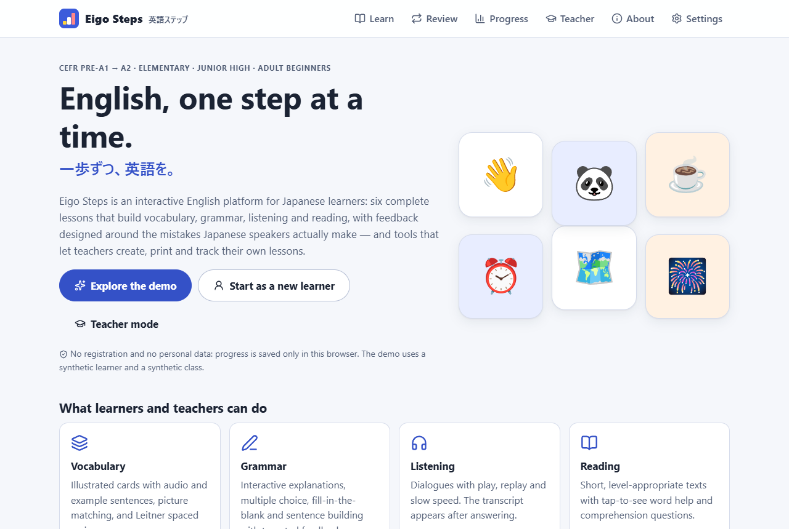                   | 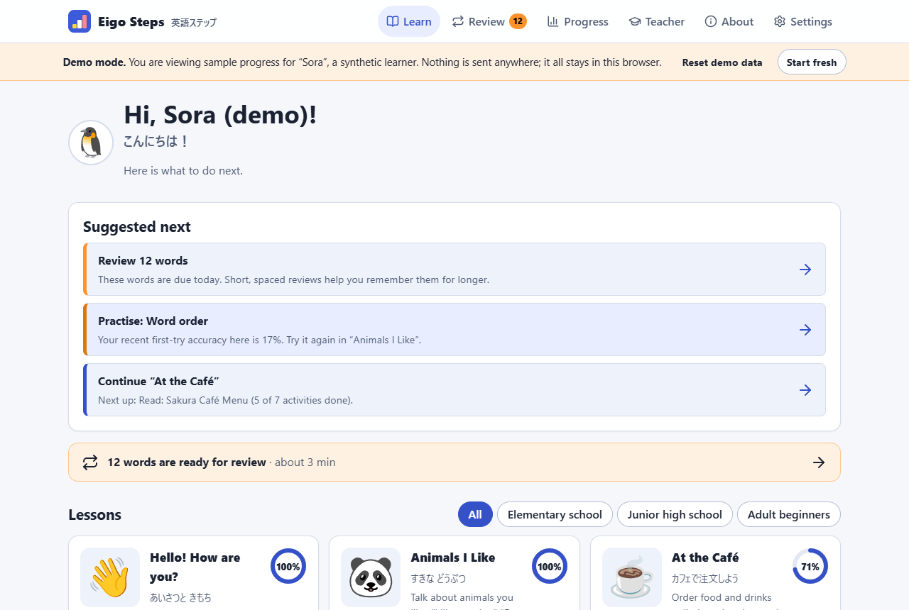            |
| 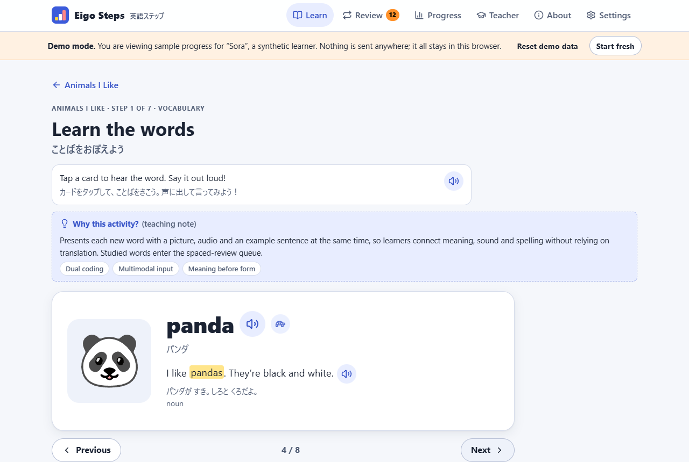             | 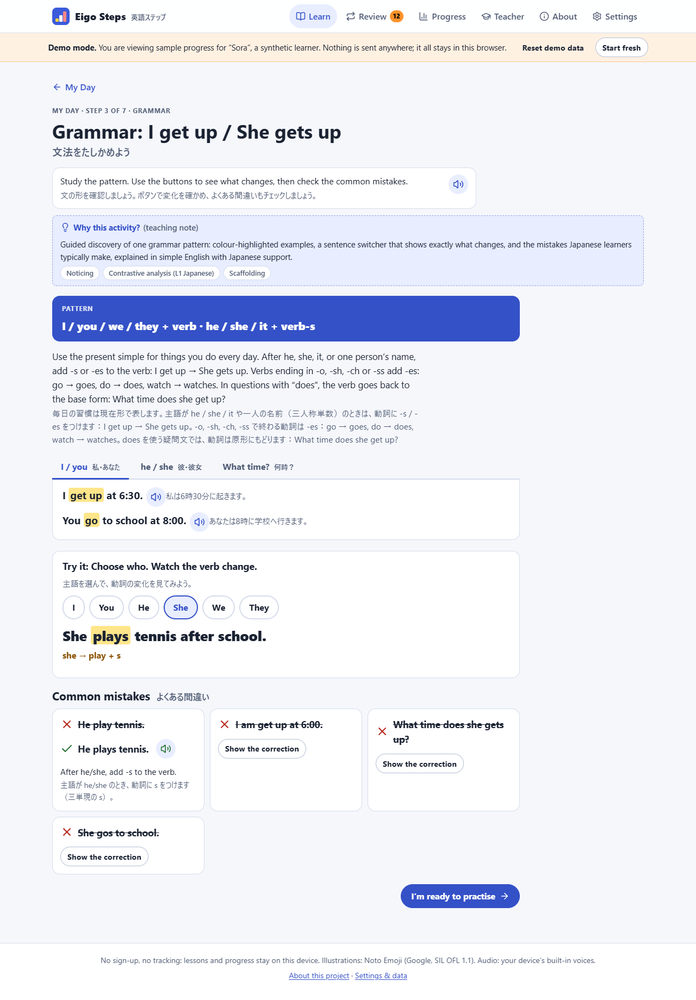                      |
| 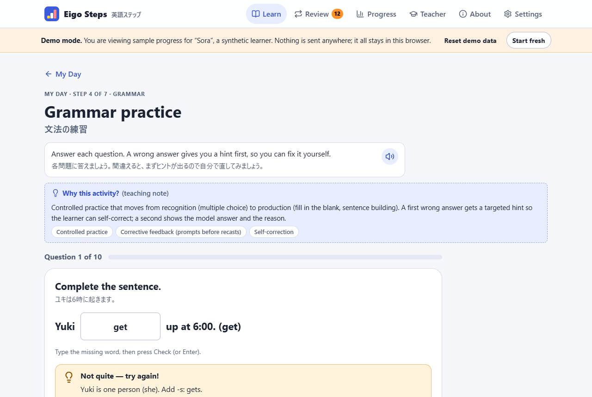 | 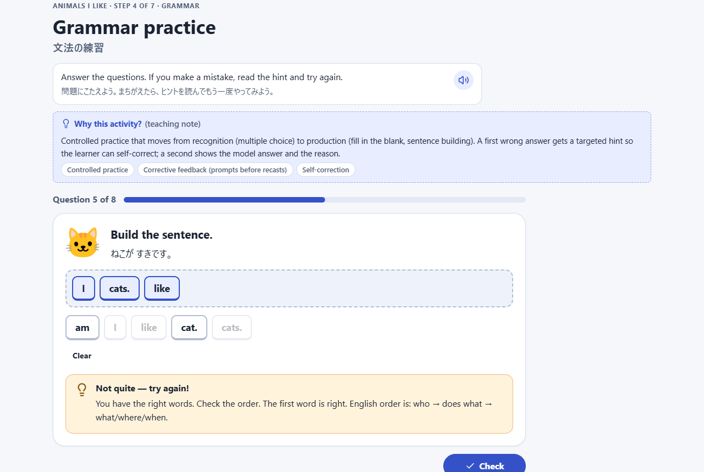   |
| 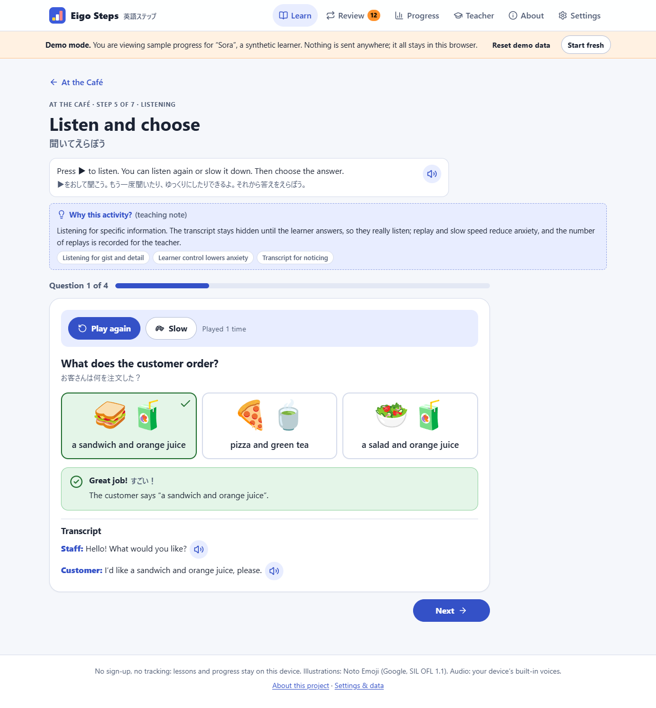               | 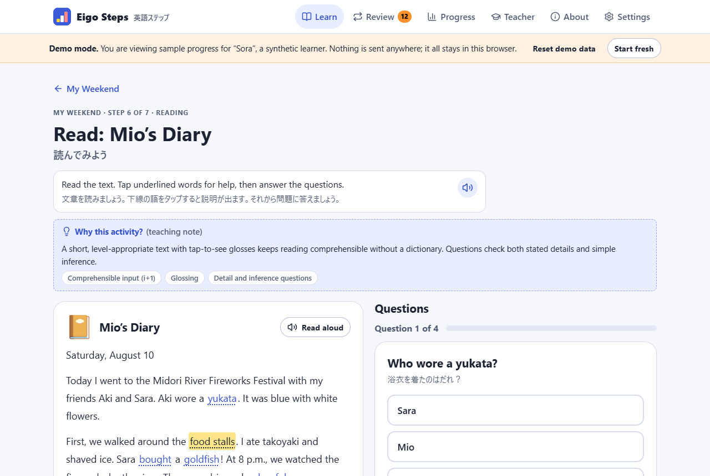         |
| 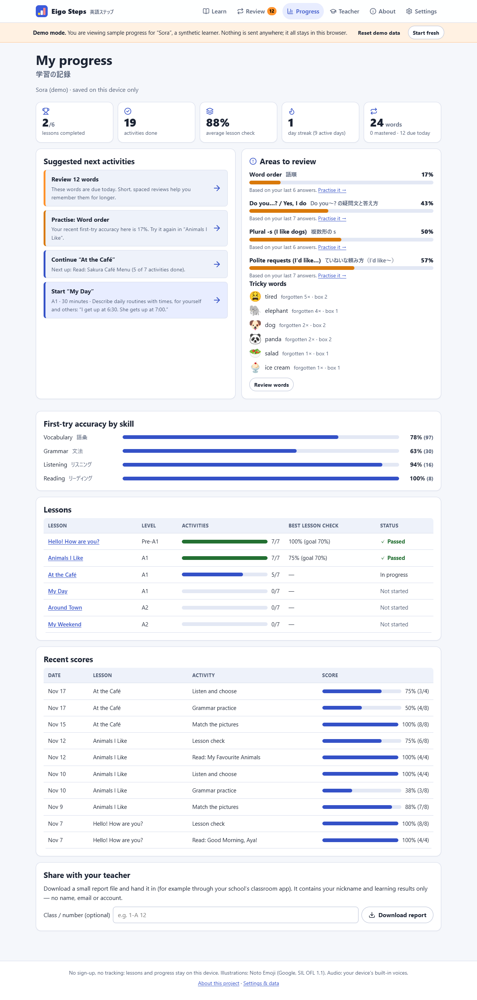                 | 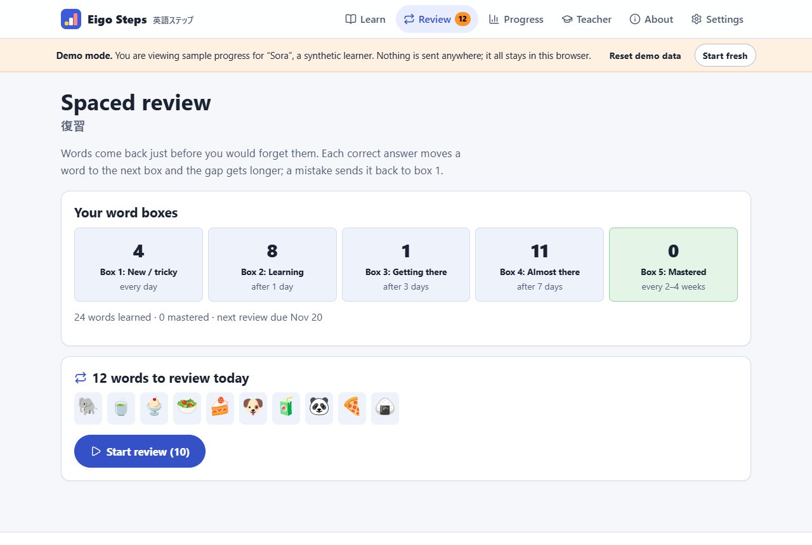          |
| 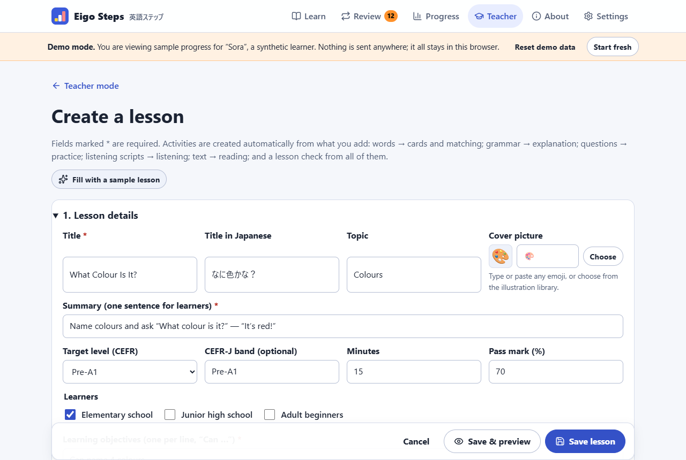       | 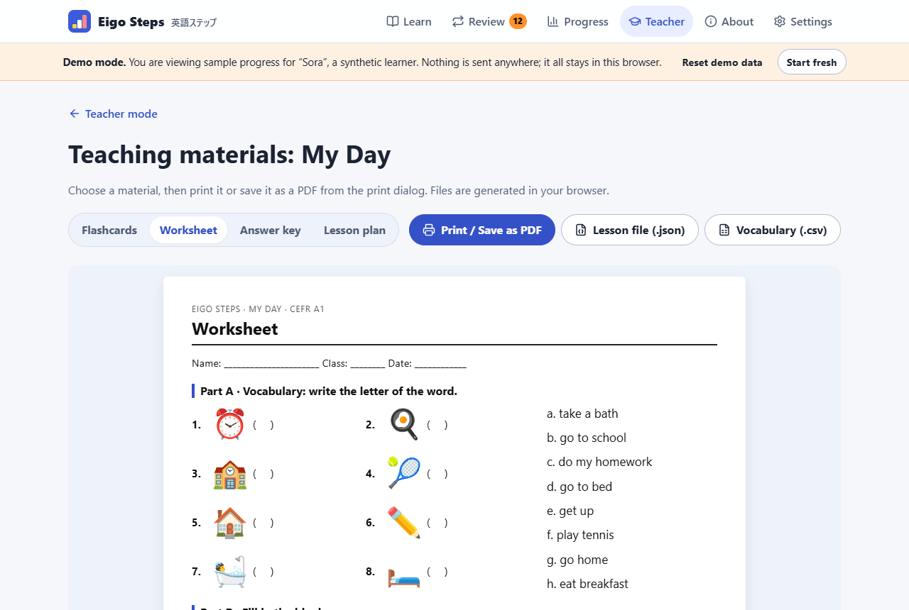 |
| 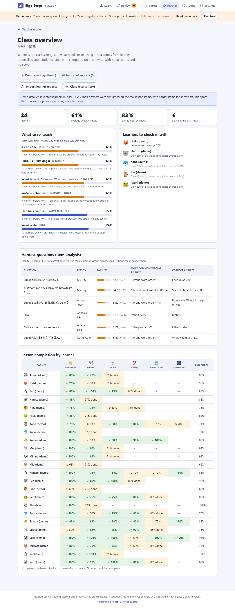    | 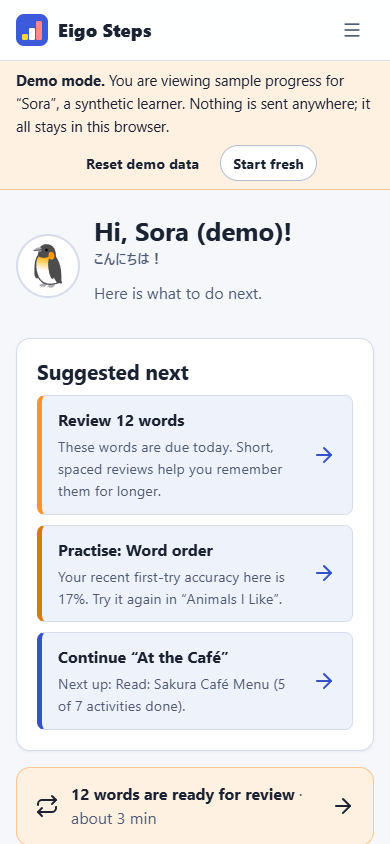                   |

More detail: [Case study](CASE_STUDY.md) · [Technical documentation](TECHNICAL.md)
